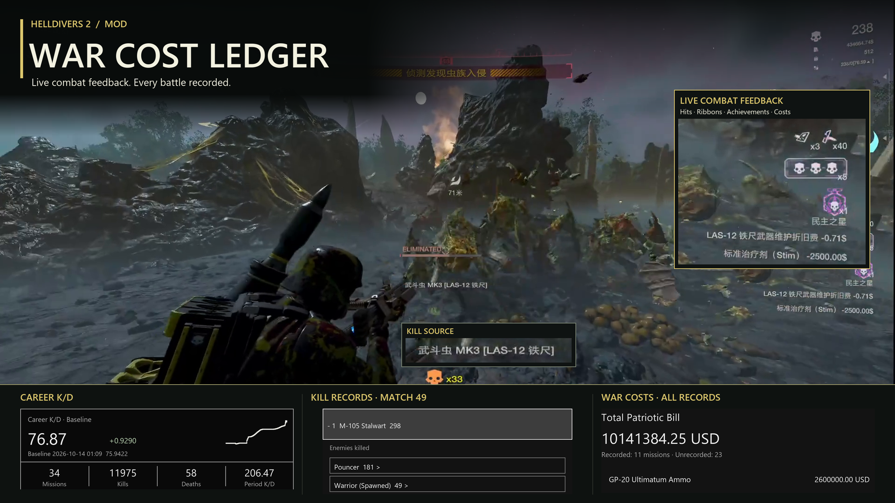

# HD2 War Cost Ledger · 战果与战争账单

**0.4.66** · Combat feedback, career records and an optional fictional war-cost ledger for **HELLDIVERS 2**.

[Nexus Mods](https://www.nexusmods.com/helldivers2/mods/17499) · [Download](https://github.com/PJ1059/War-Cost-Ledger/releases/tag/v0.4.66) · [Release notes](docs/releases/v0.4.66.md) · [Build from source](docs/BUILDING.md) · [Credits](THIRD-PARTY.md) · [Data and image sources](docs/DATA-SOURCES.md)

## Features

- **Live combat feedback:** hit, penetration and ricochet indicators; ribbons, medals and achievement notifications; a single latest `Target [Source]` kill notice that disappears after five seconds without a new kill.
- **Career archive:** session and lifetime K/D, trend charts, mission history, weapon/enemy breakdowns, death records, search and time filters. Expand an entry to inspect it; click again to collapse it.
- **Ribbons and achievements:** six giant and eighteen heavy enemy variants use individual monochrome icons. Includes fire/gas kills, melee, streaks, scouting and bughole demolition where supported. The vehicle achievement requires 100 body-impact kills in one mission.
- **Optional war-cost ledger:** supported stratagem calls, ammunition, grenades, stims and laser heat-sink/maintenance costs; per-mission and period totals with expandable breakdowns. Prices are fictional project estimates, not official prices or real charges.
- **Automatic language:** Simplified/Traditional Chinese game languages retain the Chinese interface. Other game languages use English. Settings, notices and career views follow the selected language.

The source resolver combines observed runtime evidence with weapon/projectile/explosion/beam/arc catalogs. A continuous damage chain can retain the last known weapon through unknown damage when damage observations remain within five seconds. Shared effects, simultaneous kills and unavailable events can still produce unknown or approximate attribution; this is not a guarantee of perfect statistics.

0.4.66 adds target-bound hellpod protection against death self-explosions and bounded ground-fire attribution for nine source families across eleven exact explosion events. Spray-created fire remains a documented gap; see the [release notes](docs/releases/v0.4.66.md).

## Installation

1. Exit the game. Install the dependencies below separately.
2. Import `HD2-War-Cost-Ledger-0.4.66.zip` into Arsenal and enable only one version of this mod. Keep **Bingus Shared Loader last** in the load order.
3. Open **ESC → MODS → War Cost Ledger** to configure the mod. **F8** toggles the combat display. Visit the **Armory → Career** page for the archive.

| Dependency | Version used by this project |
| --- | --- |
| [HD2Runtime — SkyeShade](https://github.com/SkyeShade/HD2Runtime) | 0.30.3 |
| [Mod Options Menu — CowboyBingus](https://github.com/CowboyBingus/ModOptionsMenu) | v1.2 API |
| [HD2 HUD+ — DDRK1ing / DDRK1NG](https://www.nexusmods.com/helldivers2/mods/15298) | 0.2.1 / 0.2.4 host |
| [Bingus Shared Loader — CowboyBingus](https://github.com/CowboyBingus/BingusSharedLoader) | v19 |

These are the versions used or checked, not a claim that they are the latest upstream versions. Game and dependency updates may require compatibility work. Reference mods credited below are **not** additional requirements.

The ledger is stored locally at `%LOCALAPPDATA%/HD2Runtime/mod_data/mods_hd2_costs_war_cost_ledger.json`. Back it up before manual changes. The mod records what it observes while enabled; it cannot reconstruct missing historical events. Disabling cost recording preserves existing bills. Disabling kill-source notices only hides the notice; career recording continues.

## Scope and verification

The release is an experimental native-runtime integration. Offline behavior, catalog and package checks accompany the source. The supplied gameplay demonstrates combat feedback; not every weapon, enemy, multiplayer scenario or translated screen has been exhaustively tested in-game. Some discovery and destruction attribution uses proximity/time evidence. Unsupported or ambiguous records remain unknown.

For current implementation boundaries see [LIMITATIONS.md](LIMITATIONS.md). Older research documents describe the version named in their title and may contain rules that were later replaced. The current damage-chain window is **five seconds**.

The public tree and release exclude personal ledgers, logs, sampling dumps, deployment backups and complete third-party mod packages. [Building](docs/BUILDING.md) documents the external SDK/game files and research fixtures needed for particular checks.

## Sources, credits and license

**Uses code / research from HD2Runtime by SkyeShade**  
https://github.com/SkyeShade/HD2Runtime

Thanks to CowboyBingus, DDRK1ing / DDRK1NG, DrOrangi and jadeeeeeeeeee, AxoloFox, the OVERWATCH HUD contributors, plataodomo, the HD2 Enemy Reinforcement HUD contributors, xypwn/Filediver contributors, the resource-ID and damage-sheet maintainers, and Helldivers Wiki, DiversHub and Helldivers Training Manual contributors. Their specific contributions and verified links are documented in [THIRD-PARTY.md](THIRD-PARTY.md).

Prices, the fixed currency snapshot, hashes, damage tables, enemy names and each enemy-ribbon image are documented in [DATA-SOURCES.md](docs/DATA-SOURCES.md). Enemy icons are monochrome edits of existing game renders. Some medal/melee artwork uses image generation and manual review. Cover images use supplied gameplay and recorded panel data.

[MIT](LICENSE) applies to original project code/documentation only. HD2Runtime-derived portions and third-party/game assets retain their own terms; see [NOTICE](NOTICE). The entire artwork collection is **not** offered under MIT. This is an unofficial fan project, unaffiliated with Arrowhead Game Studios or Sony Interactive Entertainment.

## 中文说明

这是《绝地潜兵 2》的战果与虚拟战争账单 MOD。当前版本 **0.4.66** 提供命中与穿甲反馈、绶带和成就、击杀来源、生涯 KD 曲线、逐局/武器/敌人/死因档案，以及可关闭的战争费用统计。

简体或繁体中文游戏语言使用中文，其他语言自动切换英语。击杀提示只保留最新一条，无新击杀五秒后消失；关闭提示仍继续记录生涯。战争账单为项目自定的虚拟军需价格，不是真实扣款。

退出游戏后，在 Arsenal 导入上方 Release 中的 ZIP；单独安装表中四项依赖，Shared Loader 最后加载。游戏内进入 **ESC → MODS → 战果与战争账单**，在**军械库 → 生涯**查看档案。

当前已知伤害追溯窗口为 **5 秒**。密集击杀、共享伤害和缺失事件仍可能出现未知或近似归属，离线通过不代表所有武器与多人场景已实机验证。原始历史账目不会因英语显示而改写。

本仓库公开原创代码、构建工具、可公开的检查和审核素材；不上传个人账本、日志、采样或其他 MOD 完整发行包。各项数据与参考 MOD 的贡献见上方来源文档；原创代码文档采用 MIT，第三方与游戏素材另循其原有条款。
